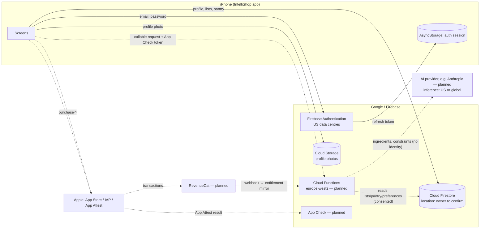

# Personal Data Inventory and Data-Flow Map — IntelliShop V2

| | |
|---|---|
| Version | 0.1 (draft for owner review) |
| Date | 28 October 2026 |
| Basis | Source code on `feature/v2-production-rebuild` at commit `c836629`; planned architecture in `AI_ARCHITECTURE.md`, `SUBSCRIPTION_ARCHITECTURE.md`, `SUBSCRIPTION_ENTITLEMENTS.md` |
| Status | **Draft.** Not legal advice. Planned items are marked as such and must be re-verified against the code that actually ships. |

Every row states whether the processing exists **in the current code** (verified by reading the source) or is **planned** for a later milestone. A privacy policy or App Store declaration must describe the shipped build, not this plan.

Source IDs (S-xx) refer to the source register in `LEGAL_COMPLIANCE_MATRIX.md` §1.

---

## 1. Controller and processors

| Role | Party | Status | Evidence | Open points |
|---|---|---|---|---|
| Controller | **[OWNER TO CONFIRM: legal name of the person or company operating IntelliShop]** | — | — | Sole trader or limited company; postal address; contact email (see `LEGAL_WORKSTREAM_PLAN.md` §3) |
| Processor — authentication | Google (Firebase Authentication) | **In use** | `firebase/authHelpers.js` | Firebase states Authentication "is run only from US data centers" (S-30). Transfer mechanism to be confirmed in the Firebase Data Processing and Security Terms the owner accepts. |
| Processor — database | Google (Cloud Firestore) | **In use** | `context/ShoppingListContext.jsx`, `context/StockContext.jsx`, `firebase/authHelpers.js` | Database location of `intellishop-1f62f` unknown (owner to check: Firestore → Settings). New projects planned in `europe-west2` (London). |
| Processor — file storage | Google (Cloud Storage for Firebase) | **In use** (profile photo) | `firebase/storageHelpers.js` `uploadUserProfileImage` | Bucket location unknown. |
| Processor — server functions | Google (Cloud Functions 2nd gen) | Planned (M2–M3) | `AI_ARCHITECTURE.md` §2 | Region `europe-west2` planned. |
| Processor — device integrity | Google (Firebase App Check with Apple App Attest) | Planned (M2–M3) | `AI_ARCHITECTURE.md` §3 | App Attest is an Apple service; attestation material goes to Apple (S-30). |
| Processor — AI inference | Anthropic (Claude API), provisionally | Planned (M3) | `AI_ARCHITECTURE.md` §6.3 (subject to a quality gate) | Anthropic acts as "data processor" for the Claude API (S-33). Inference location options are only `us` or `global` (S-34), so this is an international transfer. The DPA and transfer mechanism must be confirmed from Anthropic's commercial terms before launch. |
| Processor — subscriptions | RevenueCat | Planned (subscription milestone) | `SUBSCRIPTION_ARCHITECTURE.md` | RevenueCat describes itself as a processor; DPA forms part of its standard terms (S-35, S-36). Storage location and transfer mechanism not stated on the pages reviewed. |
| Independent party — payments | Apple (App Store, In-App Purchase) | Planned | — | Apple collects payment as the developer's agent or commissionaire (S-23 §1.1, §3.1). Apple processes payment data under its own terms; IntelliShop never receives card details. |
| Not used | Analytics, advertising, crash-reporting or tracking SDKs | **None in the dependency list** | `package.json` (26 runtime dependencies) | Any addition must update this inventory, the privacy policy and the App Privacy answers. |

---

## 2. Data inventory

**Lawful bases** are *proposed* for owner and legal review. UK GDPR Art. 6 basis, plus the Art. 9 condition where special category data is involved.

### 2.1 Account and profile

| # | Data | Source | Where stored (current code) | Purpose | Proposed lawful basis | Retention (proposed) | In code? | Findings |
|---|---|---|---|---|---|---|---|---|
| D1 | Email address | User at registration | Firebase Auth; Firestore `users/{uid}.email` | Account, sign-in, password reset, service messages | Contract (Art. 6(1)(b)) | Life of account; Firebase removes deleted users from live and backup systems within 180 days (S-30) | **Yes** | — |
| D2 | Password | User | Firebase Auth only (hashed by Firebase) | Sign-in | Contract | Life of account | **Yes** | Minimum length is 6 characters (`RegisterScreen.jsx` `validateStep1`); review in M2. |
| D3 | Display name ("full name") | User, **required** | Firestore `users/{uid}.displayName` | Personalisation | Contract | Life of account | **Yes** | The form labels it as full name. A first name or nickname would be enough (minimisation). |
| D4 | Phone number | User, optional at registration | Firestore `users/{uid}.phoneNumber` | **No purpose in the app** | None identified | — | **Yes** | **Not needed by any feature.** Remove in M2 (UK GDPR Art. 5(1)(c); Apple 5.1.1(iii), (v) — S-20). |
| D5 | Street, city, postcode, country | User; **postcode required** (`validateStep2`) | Firestore `users/{uid}.address` | **No current purpose** (no store-location feature uses it) | None identified | — | **Yes** | **Mandatory postcode with no feature using it** conflicts with minimisation and Apple 5.1.1(v): "Apps may not require users to enter personal information to function, except when directly relevant to the core functionality" (S-20). Remove in M2. Re-introduce only an *optional* area or postcode district if a licensed store feature needs it. |
| D6 | Profile photo | User, from photo library (system picker) | Cloud Storage `profile_images/{uid}/…`; download URL in Firestore `users/{uid}.photoURL` and in the Firebase Auth profile | Avatar | Contract (optional feature) | Until replaced or the account is deleted | **Yes** (upload path wired; NOT TESTED on a device) | Replacing a photo leaves the old file in Storage (orphaned personal data). Download URLs act as unauthenticated links. Decide in M2: keep the feature with clean-up and rules, or drop it. |
| D7 | Account timestamps | System | Firestore `users/{uid}.createdAt` | Account administration | Contract | Life of account | **Yes** | — |
| D8 | IP address, user agent (authentication) | Device, via Firebase Auth | Google | Security and abuse prevention | Legitimate interests (security) | "A few weeks" for logged IPs (S-30) | **Yes** (by Firebase) | Must be disclosed in the privacy policy. |
| D9 | Authentication session (refresh token) | Firebase Auth | Device: AsyncStorage (`getReactNativePersistence`) | Keep the user signed in | Contract; PECR: strictly necessary | Until sign-out or uninstall | **Yes** | Stored in the app sandbox via AsyncStorage, **not in the iOS Keychain**. Do not describe it as Keychain-protected. |

### 2.2 Shopping lists and pantry

| # | Data | Where stored | Purpose | Proposed basis | Retention | In code? | Findings |
|---|---|---|---|---|---|---|---|
| D10 | Shopping lists: names, items (name, quantity, unit, category, notes, price if user-entered, checked state), timestamps, `userId` | Firestore `shoppingLists/{id}` (top level, filtered by `userId`) | Core feature | Contract | Until the user deletes them or the account | **Yes** | **Security Rules are not in the repository** (no `firestore.rules`), so access control is unverified. Ownership is enforced only by client queries. Blocking item for M2. |
| D11 | Pantry items: name, quantity, unit, minimum quantity, category, expiry date, last purchase date, `userId` | Firestore `stockItems/{id}` | Core feature (running low, expiring soon) | Contract | As above | **Yes** | Same Security Rules gap. Purchase and consumption patterns can reveal lifestyle, and potentially health or religion (e.g. gluten-free or halal products), when combined. This is treated in the DPIA screening. |
| D12 | List and pantry names in device logs | `console.log` in `ShoppingListContext.jsx` (98 console calls across the app) | Debugging | — | Device log buffer | **Yes** | Production builds log the user ID and list names. Strip or guard with `__DEV__` in M2 (security logging rule; S-01 Art. 5(1)(f)). |
| D13 | Purchase history (trips completed, items bought) | Planned: `users/{uid}/trips` | Finish Shopping → Pantry Update | Contract | Owner decision (e.g. 24 months, user-deletable) | Planned (M5) | Do not build until a retention period is decided. |

### 2.3 Dietary preferences, allergies and AI

| # | Data | Where stored | Purpose | Proposed basis | Retention | In code? | Findings |
|---|---|---|---|---|---|---|---|
| D14 | **Allergies and intolerances** | Planned: `users/{uid}/private/preferences` | Exclude or warn about ingredients in AI recipes | Art. 6(1)(a) consent **and** Art. 9(2)(a) **explicit consent** (health data — S-01 Art. 4(15), Art. 9) | Until the user removes them, withdraws consent or deletes the account | Planned (M3) | Optional; off by default; separate from Terms; withdrawable in Settings. Apple category: Health (S-24). |
| D15 | Dietary preferences (e.g. vegetarian, vegan, halal, kosher) | As D14 | Recipe filtering | Consent; **explicit consent** where the preference may reveal religious or philosophical belief (Art. 9) or health | As D14 | Planned (M3) | Treat the whole preference set as special category to avoid splitting consent per item. Apple: "Sensitive Info" includes religious or philosophical beliefs (S-24). |
| D16 | AI request content: ingredient names, quantities, units, expiry dates, recipe mode, dietary and allergy constraints (if consented), servings | Sent from Cloud Functions to the AI provider | Generate recipes, suggestions and optimisation | Contract (feature the user requests); allergy and diet parts only with D14/D15 consent | Provider retention per its terms. Anthropic's page says prompts and outputs are not retained by default except for specified "Covered Models", and flagged content may be kept up to 2 years (S-33). **To be confirmed contractually.** | Planned (M3) | **Apple 5.1.2(i): explicit permission is required before personal data is shared with third-party AI (S-21).** Never send email, name, address or user ID to the provider. Use a pseudonymous request ID. |
| D17 | AI outputs (recipes, suggestions) and cache | Planned: Firestore cache keyed by input hash | Display; avoid repeat cost | Contract | Owner decision (e.g. 30 days for the cache; favourites until deleted) | Planned (M3) | Recipe favourites = user content (D18). |
| D18 | Recipe favourites | Planned | Saved recipes | Contract | Until deleted | Planned (M3) | — |
| D19 | AI usage records: hashed UID, feature, model, token counts, cost, latency, outcome | Planned: Cloud Logging and Firestore usage counters | Quotas, cost control, abuse prevention | Legitimate interests (service integrity) and contract (quota) | Owner decision (e.g. 13 months for logs; counters reset by period) | Planned (M3) | No prompts, ingredients, allergies or outputs are logged (`AI_ARCHITECTURE.md` §10). |

### 2.4 Subscriptions and billing

| # | Data | Where stored | Purpose | Proposed basis | Retention | In code? | Findings |
|---|---|---|---|---|---|---|---|
| D20 | Entitlement state (plan, period, expiry, introductory credits used, usage counters) | Planned: Firestore `users/{uid}/entitlements` mirror, server-written | Plan enforcement | Contract | Life of account. Transaction records may need to be kept after deletion for tax and dispute purposes (owner and accountant to confirm). | Planned | — |
| D21 | App Store transaction identifiers, purchase history (via RevenueCat) | RevenueCat; Apple | Validate purchases; restore | Contract; legal obligation for financial records | RevenueCat retention to be confirmed; deletion on request via RevenueCat (S-36) | Planned | Apple category: Purchases → Purchase History (S-24). |
| D22 | Payment card details | Apple only | Payment | Apple's own processing | — | Never received | State this in the policy. |

### 2.5 Device, security and diagnostics

| # | Data | Where | Purpose | Basis | Retention | In code? | Findings |
|---|---|---|---|---|---|---|---|
| D23 | App Check / App Attest attestation and tokens | Apple (attestation); Google (tokens) | Block abusive or modified clients from AI and paid features | Legitimate interests (security); PECR: strictly necessary for the requested service | Tokens valid for at most 7 days; up to 30 days with replay protection (S-30) | Planned (M2–M3) | — |
| D24 | Firebase installation IDs | Google | Only if Cloud Messaging, Remote Config etc. are added | — | Until deleted via API; 180-day backup purge (S-30) | **Not used** (no such SDK) | Re-assess if push notifications are added. |
| D25 | IP address at Cloud Functions | Google | Executing requests | Legitimate interests | "Temporarily" (S-30) | Planned | — |
| D26 | Crash and diagnostic data | — | — | — | — | **Not collected** (no crash SDK; error persistence on device removed in M1) | Apple's own crash reports (opt-in at OS level) are Apple's processing. |
| D27 | Device local data: AsyncStorage keys (auth persistence; legacy `userUid` and `errorLogs` keys removed on start-up) | Device | Sign-in persistence | Strictly necessary | Until uninstall | **Yes** | — |

### 2.6 Support, rights requests and complaints

| # | Data | Where | Purpose | Basis | Retention | In code? | Findings |
|---|---|---|---|---|---|---|---|
| D28 | Support and complaint correspondence (email, message content) | **[OWNER TO CONFIRM: support mailbox provider]** | Support; data protection complaints (DPA 2018 s.164A, in force 19 June 2026 — S-04) | Legal obligation (complaints); legitimate interests (support) | Owner decision (e.g. 2 years after closure) | Not built | Apple category: Customer Support (S-24). |
| D29 | Rights-request log (request type, dates, outcome; no copies of data) | Owner's records | Accountability (Art. 5(2)) | Legal obligation | Owner decision (e.g. 3 years) | Not built | — |
| D30 | Consent records (what was consented to, policy version, timestamp, withdrawal) | Planned: `users/{uid}/consents` | Show valid consent (Art. 7(1)) | Legal obligation | Life of account, plus a minimal record after deletion only if legally justified (owner and legal) | Planned (M2–M3) | — |

### 2.7 Account deletion and backups

| # | Item | Current state | Plan |
|---|---|---|---|
| D31 | In-app account deletion | **Not implemented.** No `deleteUser` or delete-account code exists. | M2: callable function deletes Auth user, `users/{uid}` and subcollections, lists, pantry, Storage files, AI cache, entitlement mirror; calls the RevenueCat customer deletion; shows the Apple billing notice (S-22). |
| D32 | Backups | None configured (Firestore export requires Blaze — `OWNER_ACTIONS_BEFORE_M2.md` C4) | Retention of exports to be decided (e.g. 35-day rolling). The policy must state that deleted data can persist in backups until they expire. Firebase Authentication purges deleted users from backups within 180 days (S-30). |
| D33 | Email after deletion | Decision D4: **no persistent email tracking after deletion** | To prevent repeated Free credits without keeping emails, the plan uses a salted hash only if the owner and legal review approve it. **Currently not planned** — any such record must appear in the privacy policy. |

---

## 3. Data-flow map

Solid lines = present in the current code. Dotted lines = planned.

## 4. International transfers

| Flow | Destination | Status | Mechanism (to confirm) |
|---|---|---|---|
| Firebase Authentication | United States | **Current** | Google relies on its Data Privacy Framework certification including the "UK Extension to the EU-U.S. DPF" (S-30); UK adequacy regulations for the US under the UK–US data bridge (S-31). The owner must accept the Firebase Data Processing and Security Terms in the console. |
| Firestore and Storage | Project location (unknown for `intellishop-1f62f`) | **Current** | If not UK, document the location. If outside the UK and not covered by UK adequacy regulations, a transfer mechanism is needed. |
| AI provider | US or global | Planned | Anthropic DPA, plus data bridge, IDTA or Addendum, **to be confirmed from the signed terms**. Inference geography options are `us` (1.1× price) or `global` (S-34). |
| RevenueCat | Not stated on the pages reviewed | Planned | Per the RevenueCat DPA (S-35). To be confirmed. |

The UK–US data bridge depends on the EU–US DPF. The EU General Court dismissed the *Latombe* challenge on 3 September 2025; an appeal was possible (S-32). Re-check the status before launch.

## 5. Actions arising

| ID | Action | Milestone |
|---|---|---|
| DF-1 | Remove phone number and address from registration and profile; migrate existing records only with owner approval and a verified backup | M2 |
| DF-2 | Write, test and deploy Firestore and Storage Security Rules (ownership by path) | M2 |
| DF-3 | Strip production `console.log` of identifiers and content | M2 |
| DF-4 | Implement in-app account deletion (D31) | M2 |
| DF-5 | Profile photo: delete the previous file on replacement; restrict Storage rules; or remove the feature | M2 |
| DF-6 | Consent records collection (D30) | M2–M3 |
| DF-7 | Confirm the Firestore and Storage location of every project; record it here | Owner, before M2 |
| DF-8 | Confirm processor terms (Firebase DPST acceptance, Anthropic DPA, RevenueCat DPA) and record the versions | Owner, before M3 / subscription milestone |
| DF-9 | Decide retention periods marked "owner decision" | Owner, before the privacy policy is finalised |
